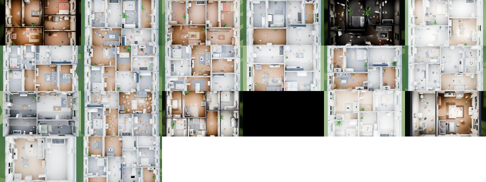
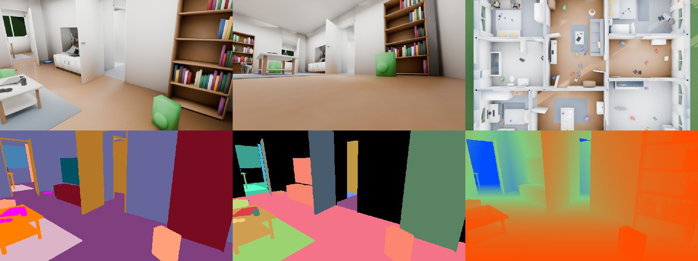
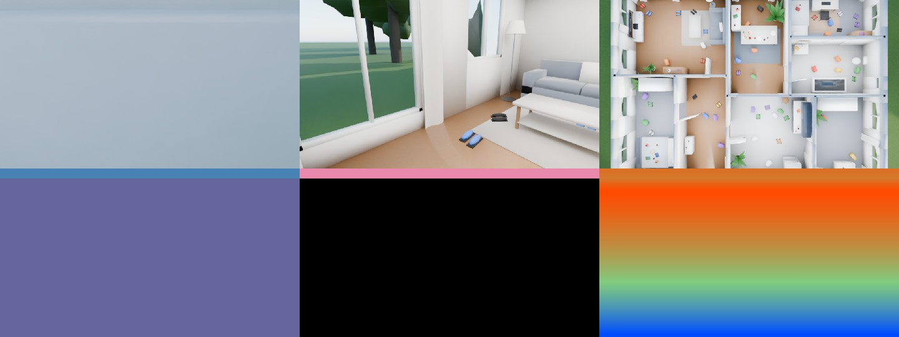
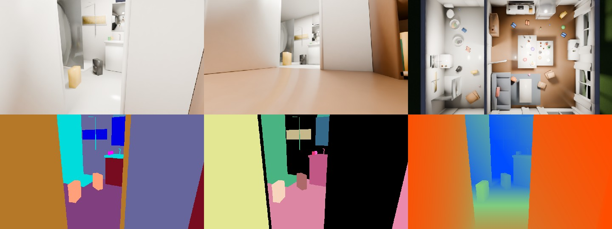
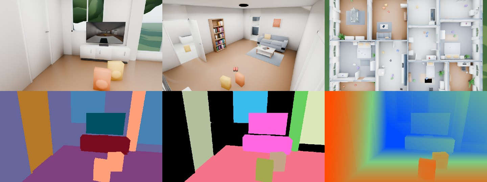

# `homesim` — 20 indoor house scenarios for home robots

`homesim` reuses the `agrifield` rendering and ground-truth pipeline (Cycles RGB plus exact
semantic, instance and depth passes, per-frame JSON and COCO) to build **procedural furnished
houses** for service robots, robot vacuums and mobile manipulators.



## What gets generated

* **Floor plan.** A BSP split of the footprint into rooms (living, kitchen, dining, bedrooms,
  kids room, office, bathroom, laundry, hallway). Doors connect every room (the tests check
  connectivity). Open-plan layouts get wide openings, exterior walls get windows, and there is
  a front door.
* **Shell.** Walls with door and window openings, per-room floors (wood, tile, carpet, concrete)
  and ceilings, door leaves at random open angles, window frames and glass that lets sun and
  sky light through, and curtains.
* **Furniture**, placed by room type with wall and door clearance rules: sofas, armchairs,
  coffee tables, TV units, bookshelves with books, dining sets, kitchen runs (cabinets,
  countertop, sink, hob, wall units), fridges, beds with pillows and blankets, nightstands,
  table and floor lamps, wardrobes, dressers, desks with monitors, office chairs, toilets,
  basins with mirrors, bathtubs, showers, washing machines, rugs, plants, pictures and stairs.
* **Clutter** for grasping and tidying, placed on support surfaces (counters, tables, desks,
  nightstands, shelves) and on the floor: mugs, cups, bottles (incl. glass), cans, bowls,
  plates, fruit bowls, books, laptops, phones, remotes, controllers, keys, vases, toys (blocks,
  balls, teddies, cars), shoes, backpacks, laundry baskets, clothes piles and cardboard boxes.
  Six themes: tidy, messy, kids, laundry, moving, party (knocked-over bottles).
* **People** (standing, bending, crouching) and **pets** (dogs and cats, standing or lying).
* **Lighting.** Daylight through windows plus bounce fill, ceiling lights and lamps for
  evening, night with only the robot's light, and five interior styles (modern, scandinavian,
  rustic, industrial, dark).

## Scenarios

`python scripts/generate_houses.py --list` lists the catalog in `homesim/scenarios.py`:

| scenario | house | focus |
|---|---|---|
| studio_tidy_morning | studio | navigation, mapping |
| studio_messy_evening | studio, lamps on | object search, tidying |
| apartment_vacuum_robot | 2-bed apartment | coverage planning, floor obstacles (vacuum camera) |
| apartment_night_lamps | 2-bed, rustic, night | low-light navigation |
| family_house_kids_toys | 3-bed family house | toy detection, tidying, grasping |
| family_kitchen_manipulation | 3-bed, open plan | tabletop grasping on counters and tables |
| family_people_and_pets | 3-bed | person detection, social navigation, pet avoidance |
| bungalow_rustic_afternoon | bungalow, rustic | navigation, domain shift |
| loft_industrial_open_plan | loft, 3.2 m ceiling | large open spaces |
| scandinavian_minimal_noon | 2-bed, minimal | low-texture scenes for visual odometry |
| closed_doors_navigation | 2-bed, doors mostly closed | door detection and opening (open angle annotated) |
| villa_multi_room_mapping | 11-room villa | exploration, room classification |
| elderly_care_home | care home with residents and stairs | assistive robotics, hazards |
| home_office_desks | 2 offices | desk objects, tabletop |
| moving_day_boxes | 2-bed full of boxes | obstacle and box detection |
| party_aftermath | open plan, evening | bottles, cans and cups everywhere |
| laundry_day | bungalow | deformable clothes, baskets |
| dark_low_contrast | dark style, dim | depth and segmentation edge cases |
| glass_and_mirrors | 1-bed | transparent tables and bottles, mirrors, low windows |
| pet_home_vacuum_night | 2-bed, night | pets on the floor, vacuum camera with light |

## Cameras

| camera | description |
|---|---|
| `robot_head` | 1.25 m, 15° down, 85° HFOV: service robot or manipulator head |
| `robot_vacuum` | 9 cm above the floor, 110° HFOV: robot vacuum |
| `tabletop` | 0.5 m above a cluttered support, looking down 38°: manipulation |
| `room_corner` | 2.3 m in a room corner: overview / CCTV style |
| `topdown` | above the house with ceilings hidden: floor-plan view |

Robot poses are sampled in free space (0.3 m clearance on the occupancy grid), spread across
rooms and turned toward the open part of the room.

## Outputs (per scenario)

Everything `agrifield` produces (`rgb/`, `semantic/`, `labels/`, `instance/`, `depth/`, `ann/`,
`coco_instances.json`, `scene.json`), plus:

* `floorplan.json`: rooms (type, rectangle, area), walls with door / window / opening
  intervals, front door.
* `occupancy.png`: 5 cm 2-D occupancy grid (0 free, 255 walls or furniture, 128 outside);
  origin and resolution are in `floorplan.json`.
* Per-instance attributes in `scene.json`: room, room type, door `open_angle_deg` and state,
  which support an object stands on, on-floor flag, fallen flag, person and pet pose.
  Every room floor is its own instance (`category: room`), so the instance mask doubles as
  a room segmentation.

House semantic classes (`homesim/classes.py`):
`0 background · 1 floor · 2 wall · 3 ceiling · 4 door · 5 window · 6 rug · 7 seating · 8 table ·
9 bed · 10 storage · 11 appliance · 12 counter · 13 sanitary · 14 lamp · 15 plant ·
16 small_object · 17 textile · 18 person · 19 pet · 20 box · 21 decoration · 22 outdoor · 23 stairs`

## Usage

```bash
python scripts/generate_houses.py --scenario family_people_and_pets
python scripts/generate_houses.py --all --quality draft --keep-going
python scripts/generate_houses.py --scenario villa_multi_room_mapping --poses 40 --quality final
python scripts/generate_houses.py --scenario studio_tidy_morning --seed 7          # a different house
python scripts/generate_houses.py --scenario party_aftermath --no-render --save-blend --export usd
python scripts/generate_houses.py --dump-scenario laundry_day > my_house.json      # edit, then:
python scripts/generate_houses.py --scenario-file my_house.json
python scripts/make_gallery.py --src output_houses --dst docs/gallery_houses
```

Every scenario is seeded, so the same command gives the same house; `--seed` gives a new
layout, furnishing and clutter.

| | |
|---|---|
|  |  |
|  |  |
