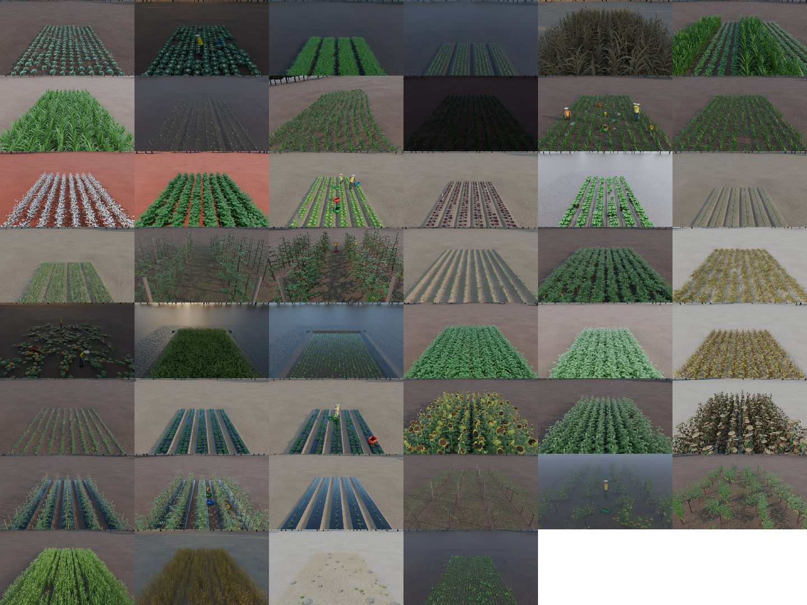
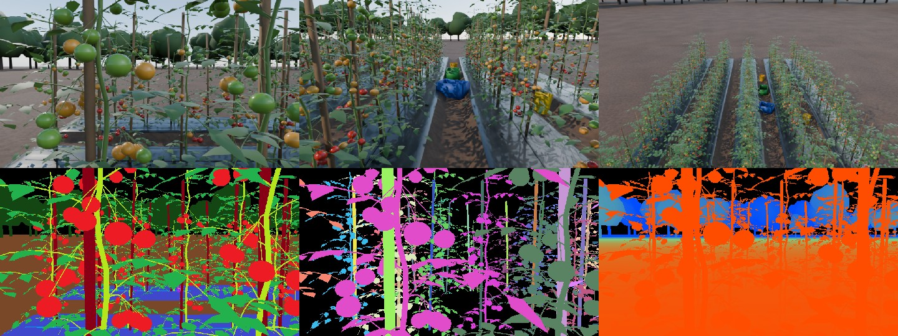
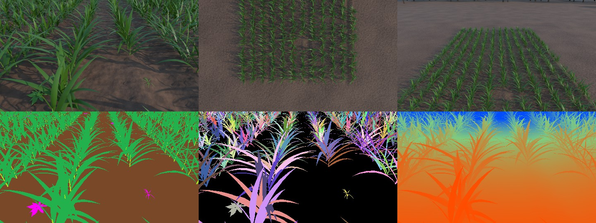
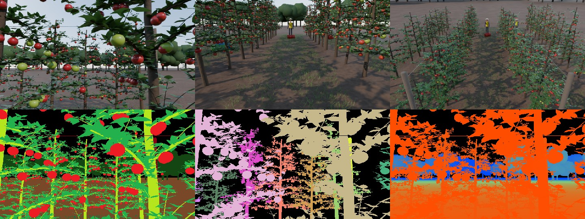
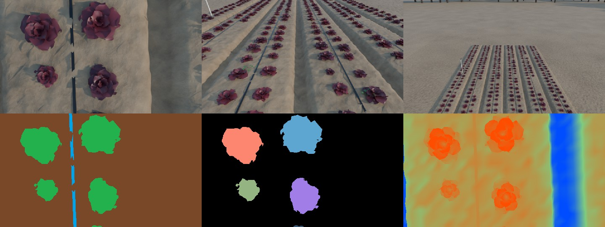
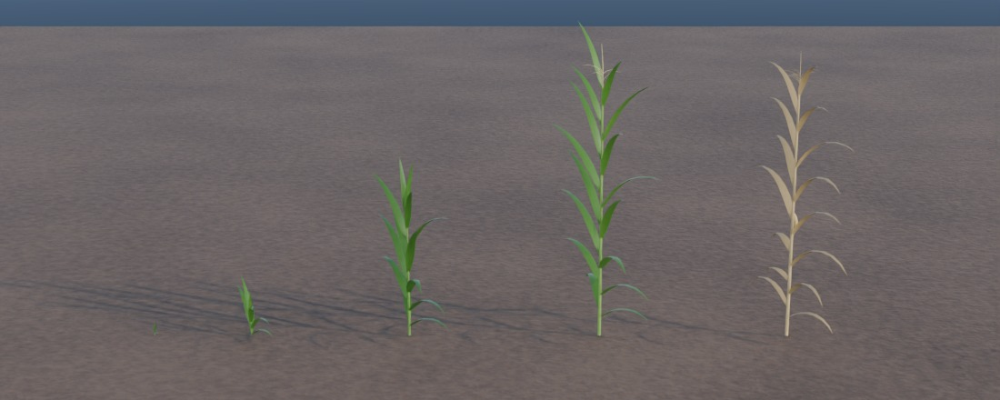
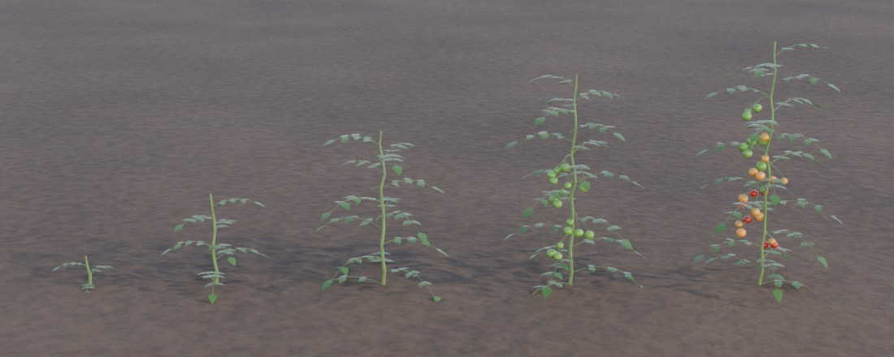

# modern-agriculture · `agrifield`

Procedural **agricultural field scenes in Blender** for training and testing field robots.
`agrifield` builds a field (crops at a chosen growth stage, weeds, soil, beds, mulch,
irrigation, trellises, obstacles, people, lighting and weather), drives a virtual robot
through it, and renders camera images together with pixel-exact ground truth:

| output | content |
|---|---|
| `rgb/*.png` | Cycles path-traced image |
| `semantic/*.png`, `labels/*.png` | 17-class semantic mask (palette / class-id) |
| `instance/*.png` | 16-bit instance id per plant, weed, rock, person, post... |
| `depth/*.png`, `depth/*.npy` | depth in mm (uint16) / metres (float32), camera Z |
| `ann/*.json` | intrinsics `K`, extrinsics (OpenCV), visible objects with bbox / area / distance, fruit key-points with ripeness and visibility, crop rows projected into the image |
| `coco_instances.json` | COCO detection / instance-segmentation file (RLE masks) |
| `scene.json` | full scene ground truth: every plant (position, stage, height, 3-D bbox, fruits), rows as 3-D polylines, cameras, robot poses |
| `<name>.blend`, `.usdc`, `.glb` | optional scene export for Isaac Sim / Gazebo / other simulators |



> **Also on this branch: [`homesim`](HOUSES.md)**, 20 procedural indoor house scenarios
> (furnished multi-room homes with clutter, people, pets, doors and day/night lighting) for home
> robots, using the same renderer and ground-truth format.
> `python scripts/generate_houses.py --list`

## 48 scenarios, 16 crops

`python scripts/generate.py --list` prints the catalog (`agrifield/scenarios.py`).

| crop | scenarios (stage) | robot tasks |
|---|---|---|
| corn | V2 emergence + weeds · V6 row following · V6 contour slope · V12 under canopy · VT tassels · R6 mature golden hour · V6 dusk · V2/V6 night weeding · V6 obstacle course · corn/soy strip intercrop | weeding, navigation, phenotyping, safety, night ops |
| wheat | tillering + weeds · heading with tramlines · ripe · stubble with straw & rocks | spraying, tramline following, harvest, rock picking |
| soybean | V2 heavy weeds · R2 flowering · R6 pods · R8 mature | weeding, pod counting |
| lettuce | seedling thinning · red rosette on drip beds · heading harvest with crew · romaine after rain (puddles) | thinning, harvest, wet conditions |
| cabbage | cupping + weeds · mature harvest | weeding, head detection |
| tomato | transplants on mulch · flowering staked · ripening harvest (green/turning/red) | pollination, harvest, ripeness |
| potato | emergence on ridges · flowering · senescence | navigation, scouting |
| sunflower | bud · bloom (east facing) · mature drooping | phenotyping |
| strawberry | flowering plasticulture · fruiting harvest | pollination, harvest |
| grapevine | bud-break · veraison · harvest in fog (VSP trellis) | canopy, harvest, adverse weather |
| apple | blossom · harvest (tall spindle, trellis) | pollination, harvest |
| rice | transplanted paddy · heading | navigation in water |
| cotton | squaring · open boll | weeding, boll detection |
| onion, carrot, pumpkin | bulbing · vegetative / seedling weeding · patch harvest | weeding, harvest |

Each scenario combines: crop + stage (or a stage mix), row/plant spacing, stand gaps and size
variation, terrain (soil type, wetness, slope, undulation, curved contour rows, wheel ruts,
tramlines, raised beds, hilled ridges, paddy with bunds, puddles), plastic mulch, drip tape,
sprinklers, stakes, trellis posts and wires, weeds (7 species, 4 sizes, intra-row and patchy),
ground cover, residue, rocks, crates, buckets, tools, hoses, people (standing / bending /
crouching), 8 lighting presets (dawn, morning, noon, afternoon, golden hour, overcast, dusk,
night with robot floodlight), fog, and a background tree line.

Per-scenario previews (top: two robot cameras + overview; bottom: semantic, instance, depth)
are in [`docs/gallery/`](docs/gallery) and crop growth-stage models in [`docs/crops/`](docs/crops).

| | |
|---|---|
|  |  |
|  |  |

## Crops and growth stages

`python scripts/generate.py --list-crops`

| crop | stages (BBCH) |
|---|---|
| corn | V2 (12) · V6 (16) · V12 (32) · VT (65) · R6 (89) |
| wheat | tillering (23) · jointing (32) · heading (55) · ripe (89) · stubble (99) |
| rice | transplanted (13) · tillering (25) · heading (59) · ripe (89) |
| soybean | V2 (12) · V5 (15) · R2 (65) · R6 (79) · R8 (89) |
| lettuce (green / red / romaine) | seedling (13) · rosette (18) · heading (45) |
| cabbage | seedling (14) · cupping (19) · heading (45) · mature (49) |
| tomato | transplant (14) · vegetative (19) · flowering (61) · fruiting (75) · ripening (85) |
| potato | emergence (09) · vegetative (31) · flowering (65) · senescence (91) |
| sunflower | vegetative (18) · bud (55) · bloom (65) · mature (89) |
| strawberry | flowering (65) · fruiting (87) |
| grapevine | budbreak (09) · leafy (71) · veraison (83) · harvest (89) |
| apple | blossom (65) · fruitlet (72) · harvest (87) |
| cotton | squaring (51) · open_boll (89) |
| onion | vegetative (16) · bulbing (47) |
| carrot | seedling (12) · vegetative (45) |
| pumpkin | vining (35) · fruiting (87) |




## Install

Either Blender ≥ 4.2 (tested with 5.3) or the `bpy` wheel:

```bash
python3.13 -m venv .venv && .venv/bin/pip install bpy pytest   # bpy 5.x needs Python 3.13
```

Rendering uses Cycles on the CPU (works headless, no GPU needed). The ground-truth passes
are also rendered with Cycles (1 sample, emission-only override material, box filter, raw view
transform), so the masks are exact and need neither Workbench nor EEVEE.

## Usage

```bash
# one scenario, one robot pose, preview quality (960x540)
python scripts/generate.py --scenario tomato_ripening_harvest

# inside Blender instead of the bpy module
blender -b --python-exit-code 1 -P scripts/generate.py -- --scenario tomato_ripening_harvest

# a dataset: 25 poses along the row, 1280x720, all cameras of the scenario
python scripts/generate.py --scenario corn_v2_emergence_weeds --poses 25 --quality final --out data

# every scenario, quick look
python scripts/generate.py --all --quality draft --keep-going

# new random layout / plant variants
python scripts/generate.py --scenario soybean_r6_pod_counting --seed 42

# scene only, for a simulator
python scripts/generate.py --scenario orchard_apple_harvest --no-render --save-blend --export usd --export gltf

# your own scenario
python scripts/generate.py --dump-scenario corn_v6_row_following > my_field.json   # edit it
python scripts/generate.py --scenario-file my_field.json

# previews
python scripts/make_gallery.py --src output --dst docs/gallery
python scripts/showcase.py --out docs/crops            # every crop at every stage
```

Quality presets: `draft` 640x360/16 spp · `preview` 960x540/48 · `final` 1280x720/128 ·
`hd` 1920x1080/256 (override with `--samples`, `--resolution`). A preview frame takes about
20–40 s on 4 CPU cores; ground truth adds about 3 s.

### Camera rig

| camera | mount |
|---|---|
| `front` | robot, 1.0 m, pitched 32° down, 78° HFOV (raised and levelled automatically in tall crops) |
| `front_low` | robot, 0.45 m, near-horizontal, 90° HFOV (under-canopy) |
| `nadir` | straight down over the nearest crop row, kept ≥ 0.5 m above the canopy |
| `side` | looks sideways into the row at mid-canopy height (harvest / phenotyping) |
| `drone`, `drone_oblique` | 11 m nadir / 9 m oblique |
| `overview` | elevated view from the field edge |

The robot drives along an inter-row, furrow, bed centre or tramline (`robot.path`), with
small heading and lateral noise between poses. Sensor: 7.6 mm wide (≈1/1.8").

## Ground-truth conventions

* World: metres, z up, crop rows along +y, field origin at the corner of the planted area.
* Semantic classes (`agrifield/semantics.py`, also in `scene.json`):
  `0 background · 1 soil · 2 crop_foliage · 3 crop_stem · 4 crop_produce · 5 crop_flower ·
  6 weed · 7 ground_cover · 8 residue · 9 plastic_mulch · 10 irrigation · 11 structure ·
  12 rock · 13 obstacle · 14 person · 15 water · 16 background_vegetation`.
  `crop_produce` is the harvestable organ (fruit, ear, head, pod, boll, bulb, cluster).
* Instance ids are unique per scene and map to records in `scene.json → instances`
  (category `crop | weed | rock | obstacle | person | structure`, label, stage / species, row).
  Dense cereals (wheat) are instanced per 0.5 m row segment; rice per hill.
* Depth is camera-space Z (not ray length); 0 marks sky.
* `extrinsics.R_world_to_cam_cv`, `t_world_to_cam_cv` use the OpenCV camera frame
  (x right, y down, z forward); `K` is in pixels.
* Fruits: world position, radius, kind and ripeness (0 unripe … 1 ripe) per plant in
  `scene.json`; per frame they are projected with `visible = true` only when the centre pixel
  belongs to the same plant, is `crop_produce`, and the depth agrees.
* `rows_px`: each crop row's 3-D polyline projected into the image (for lane-style row detection).

## Code layout

```
agrifield/
  meshkit.py     mesh builder + primitives (leaf blades, tubes, ellipsoids, ...)
  plantkit.py    organs: trifoliate / pinnate / palmate leaves, flowers, berry clusters
  crops.py       16 crop models with growth stages
  weeds.py       7 weed species + ground-cover grass
  props.py       posts, wires, stakes, drip tape, sprinklers, rocks, crates, people, straw, trees
  terrain.py     analytic height field: beds, ridges, ruts, slope, curvature, paddy
  materials.py   procedural Cycles materials, semantic tagging, GT override materials
  environment.py sun / sky / fog / exposure presets, robot floodlight
  cameras.py     rig, robot poses, intrinsics / extrinsics / projection
  scene.py       assembles a scenario (instancing shared plant meshes)
  render.py      Cycles setup, RGB and ground-truth passes
  annotate.py    masks, depth, per-frame JSON, COCO
  pipeline.py    scenario -> files
  scenarios.py   the 48-scenario catalog
scripts/  generate.py · showcase.py · make_gallery.py
tests/    python -m pytest tests -q
```

Plants are built as a few random variants per crop/stage and placed as linked duplicates,
so Cycles instances them. A field typically has 400–2,500 annotated objects and builds in
about 1 s.
